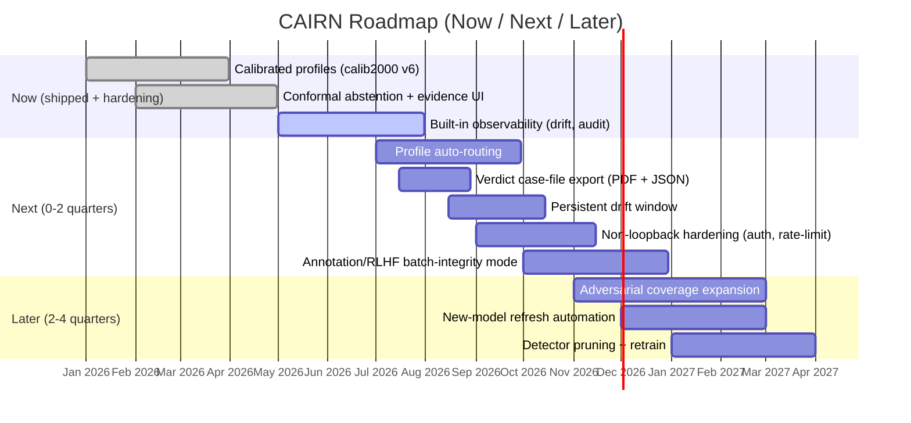

# CAIRN: AI Product Requirements Document (PRD)

**Product:** CAIRN, verdict-grade LLM authorship detection
**Author:** Product
**Contributors:** Engineering, Calibration/Research, Design
**Status:** Draft for review
**Last updated:** 2026-06-24

> **How can we use AI to help our users?**
> Reviewers are being asked "was this written by a machine?" thousands of
> times a week and have no defensible way to answer. CAIRN uses AI on both
> sides of the problem: an ensemble of statistical and LLM-backed
> *detectors* extracts signal a person cannot see unaided, and a calibrated
> *fusion + conformal* model turns those signals into a probability that
> means what it says, with an uncertainty interval and per-feature
> evidence a person can actually defend. AI is essential to this product;
> the task cannot be done without it.

---

## Author's note: assumptions in this draft

This PRD is written for **CAIRN as it exists in this repository** (see
`README.md`, `docs/architecture.md`, `docs/benchmarks/README.md`). Where
the template asks for strategic choices that aren't yet settled in the
codebase, I've made the following assumptions explicit so they can be
redirected before they harden:

1. **Primary persona is the *integrity/review analyst*:** someone who has
   to make and *justify* a human-vs-LLM call to an affected party (a
   student, an applicant, a contributor, a regulator). CAIRN's design
   choices (evidence spans, conformal abstention, loopback-first privacy)
   are aimed at this user, and the rest of the design follows from that.
2. **Go-to-market is open-source-led, self-host-first.** The product is
   MIT-licensed and runs on a laptop today; a managed/cloud tier is a
   roadmap option rather than the initial focus.
3. **North Star is the *confirmed determination*:** an analyzed item
   whose verdict a reviewer accepted and acted on (see §8). It connects
   volume to trust, and CAIRN already records the reviewer feedback that
   measures it.

If any of these are wrong, sections 2, 3, 7, and 8 are the ones to revisit.

---

## Table of contents

1. [About](#1-about)
2. [Market Insights](#2-market-insights)
3. [The Problem](#3-the-problem)
4. [The Solution](#4-the-solution)
5. [Requirements](#5-requirements)
6. [Challenges](#6-challenges)
7. [Positioning](#7-positioning)
8. [Measuring Success](#8-measuring-success)
9. [Launching](#9-launching)

## Relevant Documents

| Doc | What it covers |
|-----|----------------|
| [`README.md`](../README.md) | User-facing overview, detector bench, profile table, limitations |
| [`docs/architecture.md`](architecture.md) | Pipeline internals: router → cascade → fusion → decision, contracts |
| [`docs/configuration.md`](configuration.md) | Config profiles, threshold tuning, detector toggles |
| [`docs/calibration.md`](calibration.md) | Training pipeline: corpus, feature caching, profile training |
| [`docs/benchmarks/README.md`](benchmarks/README.md) | calib2000 results, profile grid, OOD validation (M4/RAID/MAGE) |
| [`docs/deployment.md`](deployment.md) | Runtime options, Docker, REST API |
| [`docs/pitch-deck.html`](pitch-deck.html) | Positioning narrative (source for much of §2 / §7) |
| [`beet2_implementation_roadmap.md`](../beet2_implementation_roadmap.md) | Phased engineering roadmap |

---

## 1. About

**TL;DR.** CAIRN is a multi-detector fusion pipeline that classifies
whether a piece of text was written by a human or generated by a large
language model. Unlike most tools, it does so *defensibly*: a
**calibrated probability**, a **conformal confidence interval**, and
**character-level evidence** showing which phrases triggered which
detector. One engine ships behind three runtimes (a local web GUI, a
FastAPI service, and a Tauri desktop app), all loopback-first so text
stays on the user's machine unless they opt in.

**The problem space.** Generative text is now indistinguishable from human
writing at a glance, but the *consequences* of getting the attribution
wrong are growing: a student accused of cheating, a job applicant
screened out, a journal article retracted, a content platform mislabeling
a contributor. The market is full of detectors that emit a confident
number with no honest uncertainty, overfit a single model family, and
cannot show their evidence, which means their verdicts do not survive a new
model release, an adversarial paraphrase, or a challenge from the person
they flagged. CAIRN's thesis: **a verdict is only worth acting on if the
detector can quantify its uncertainty, show its evidence, and survive a
new model release.**

**What "done" looks like for this product.** A reviewer pastes (or batch-
uploads) text, gets a banded verdict with a probability *and an interval*,
sees the spans and per-feature contributions behind it, can abstain
honestly when the model is unsure (the **UNCERTAIN** band), and can
defend the call afterward from a hash-chained audit trail, without the
text ever leaving their control.

---

## 2. Market Insights

### Competitor Analysis

The AI-text-detection market splits into three broad groups, plus one
modern, well-funded standout worth naming (Pangram). CAIRN targets the gap
they leave open: **honest calibration, evidence, and privacy**.

| Competitor / class | Approach | Where it leaves a gap CAIRN fills |
|--------------------|----------|-----------------------------------|
| **GPTZero, Originality.ai, Copyleaks, Winston AI, ZeroGPT** (commercial SaaS) | Hosted single-model / perplexity-burstiness classifiers; emit a % score | Text leaves the customer's machine; scores are uncalibrated and have no interval; limited per-phrase evidence; closed weights and corpus |
| **Pangram** (modern cloud classifier) | Single transformer trained with mirror-prompting + hard-negative mining; very low self-reported false-positive rate; cloud API | Strong, funded, and education-positioned, and it already markets an RLHF / ML-engineer use case, but text is sent to a cloud API; no calibrated uncertainty interval, no honest abstention, no contributor-graph, no audit trail; ill-suited to discrete labels |
| **Turnitin AI detection, Sapling** (embedded in a larger workflow) | Bundled into plagiarism / writing-assistant suites | Black-box verdicts inside a closed product; no profile/threshold control; no honest abstention; institution can't self-host |
| **Open-source detectors:** DetectGPT, Fast-DetectGPT, Binoculars, GLTR, RoBERTa-class classifiers; **RAID** benchmark | Strong single *signals*, research-grade | A single signal rather than a product: no fusion, no calibration layer, no UI/observability, no decision policy, no audit trail |

**CAIRN's differentiation (the four pillars):**

1. **Fusion across many detectors.** 17 detectors across 4 phases blended
   by an Explainable Boosting Machine. A detector tuned to 2023-ChatGPT
   and one tuned to modern LLMs each miss cases the other catches, so the
   combined ensemble outperforms any single detector.
2. **Honest calibration.** Isotonic per-detector calibration + EBM fusion
   + **split-conformal interval**, with `/health` reporting exactly which
   of four calibration tiers is active. When the probability is not
   calibrated, the system reports that rather than implying otherwise.
3. **Inspectable evidence.** Character-level spans, ranked per-feature
   contributions, and a transparent decision band. Together these give a
   verdict an analyst can defend to the person it affects.
4. **Privacy by default.** Loopback-first; the desktop shell opens no
   port; hash-only history; only the *task description* (never the
   submission) ever reaches an external provider.

### Market Analysis

- **Many vendors, little calibration.** Dozens of vendors offer a
  "% AI" score, but very few offer a *calibrated* probability with an
  uncertainty interval, almost none expose per-phrase evidence, and the
  privacy-sensitive segments (legal, healthcare, regulated enterprise,
  many education deployments) are largely unserved by SaaS-only tools.
- **The detection target keeps shifting.** Every frontier-model release
  shifts the detection distribution; our own matched-comparison eval shows
  a modern-LLM-trained detector misses ~2/3 of 2023-ChatGPT text and
  vice-versa (`docs/benchmarks/README.md`). This makes detection an
  ongoing recalibration effort rather than a one-time model build, which
  creates recurring value and a durable advantage for whoever
  operationalizes the refresh loop.
- **Trust is the deciding factor.** High-stakes buyers have been harmed by
  high-profile false positives (students wrongly accused). The buyer's
  real question is "can I defend this verdict?", which is exactly what
  CAIRN is built to support.
- **An under-tooled buyer: AI data pipelines.** Covert LLM use by
  crowdworkers and annotators is a measured phenomenon (peer-reviewed
  estimates of roughly 30 to 46% on free-text tasks) that survives policy
  and UX countermeasures, so detection rather than policy is required. The
  segment is under-tooled: surveys find only about 11% of teams use an
  automated detector, the rest relying on informal heuristics. It is
  high-value because clean, genuinely human data is what keeps training
  corpora from degrading, and proprietary prompts make privacy a hard
  requirement. See
  `docs/research/2026-06-27-data-annotation-positioning.md` for sources.

### Technology Analysis: what AI-specific solutions are competitors leveraging?

- **Perplexity / burstiness** of a reference LM (the GPTZero-class lineage).
- **Curvature methods:** DetectGPT (perturb-and-compare) and its
  efficient successor Fast-DetectGPT (analytic conditional-probability
  curvature). CAIRN implements both; `fast_detectgpt` supersedes the
  classic `perturbation` detector.
- **Cross-model contrast:** Binoculars-style two-model ratios; CAIRN's
  `contrastive_lm` and `dna_gpt` are in this family.
- **Fine-tuned transformer classifiers** (RoBERTa-class) trained per model
  family, strong in-distribution and brittle OOD.
- **CAIRN's approach on top of these:** treat each method as a *feature*,
  fuse with an interpretable model (EBM), and wrap a *conformal* guarantee,
  borrowing calibration/uncertainty machinery the single-signal tools skip.

### Customer Segments

| Segment | Why CAIRN fits | Privacy pressure |
|---------|----------------|------------------|
| **Education / academic integrity** | Defensible verdicts + abstention to avoid false accusations; spans to show a student | High (FERPA; minors) |
| **Scholarly publishing / peer review / grants** | Screen submissions at scale; audit trail for editorial defensibility | Medium to High |
| **Hiring / assessment** | Flag LLM-written take-homes & essays; must justify adverse decisions | High (regulatory/EEO) |
| **Newsrooms / fact-checking / trust & safety** | Triage suspected synthetic content; per-feature evidence for editorial calls | Medium |
| **Regulated enterprise (legal, finance, healthcare)** | On-prem / loopback is a hard requirement; audit chain for compliance | Very High |
| **Platform / marketplace integrity** | Batch + `cross_similarity` / `contributor_graph` to catch coordinated synthetic content | Medium |
| **AI data pipelines / labeling & RLHF integrity** | Batch-screen free-text annotations, SFT demonstrations, and RLHF rationales for covert LLM origin; `contributor_graph` catches repeat synthetic submitters; audit record per batch; proprietary prompts never leave the machine | Very High (proprietary prompts/IP) |
| **Detection researchers / OSS adopters** | Pluggable detector protocol, evaluation harness, BYO-dataset training | N/A |

### User Personas

**Primary: "Dana, the Integrity Review Analyst."**
Dana works in an academic-integrity office (or an editorial/T&S/compliance
equivalent). She receives flagged submissions and must decide whether to
escalate, a decision that affects a real person and may be appealed. She
is not an ML engineer. She needs: a verdict she *understands and can
defend*, an honest "I'm not sure" rather than a false-confident number,
evidence she can put in front of the affected party, and a guarantee the
submitted text never leaves the institution's control. She measures her
own success in *defensible decisions per week* rather than raw throughput.

**Secondary: "Sam, the Platform/Integrations Engineer."**
Sam wires CAIRN's REST API into a back-office pipeline (LMS, ATS, CMS, or
moderation queue). Sam needs stable contracts, batch throughput,
`calibration_status` introspection, profile selection per input type, and
observability (drift alerts, audit log) that is dependable enough to run
in production.

**Secondary: "Mara, the Data-Quality / RLHF Operations Lead."**
Mara owns the integrity of human-produced training data at a data-labeling
vendor or a frontier lab's data team. She must keep annotation,
SFT-demonstration, and RLHF-rationale free-text actually human at batch
scale, without shipping proprietary prompts to a third party. She needs: a
calibrated probability with an uncertainty interval she can threshold to a
strict false-positive budget, honest abstention on genuinely ambiguous
items, contributor-graph signals to catch repeat or coordinated synthetic
submitters, an exportable audit record per batch, and local-first
processing so prompts and submissions never leave her infrastructure. She
knows text detection cannot police discrete multiple-choice labels, so she
applies CAIRN to the free-text surface where it is effective.

**Tertiary: "Riya, the Detection Researcher."**
Riya extends CAIRN: adds a detector behind the `Detector` protocol,
trains a profile on her own corpus via the calibration pipeline, and runs
the evaluation harness (AUROC/ECE/Brier/TPR@FPR, ablation, robustness).

---

## 3. The Problem

### Use Cases

What users are trying to achieve:

1. **Single-text triage.** Paste one document; get a banded verdict with
   probability, interval, evidence spans, and per-detector breakdown.
2. **Batch screening.** Run a queue (a class's essays, a grant round, a
   moderation backlog) and sort/filter by determination, with
   cross-submission similarity to catch shared synthetic origin.
3. **Defensible escalation.** Produce an artifact a reviewer can show an
   affected party and an auditor: spans + contributions + a hash-chained
   audit record pinned to the exact model artifact used.
4. **Honest abstention.** When the signal is genuinely ambiguous, get
   **UNCERTAIN** instead of a forced binary guess.
5. **Deploy to a matched distribution.** Pick (or train) a profile that
   fits the genre/provider mix actually being seen, and tune the
   precision/recall threshold to the cost of a false positive.
6. **Operate over time.** Monitor determination distribution, feedback-
   derived accuracy, and feature drift; recalibrate when a new model
   shifts the distribution.
7. **Annotation-pipeline integrity.** Batch-screen free-text annotations,
   SFT demonstrations, and RLHF rationales for covert LLM origin; use the
   contributor-graph to catch repeat or coordinated synthetic submitters;
   export an auditable integrity record per batch. Applies to free-text
   fields; discrete multiple-choice labels are out of scope for text-based
   detection.

### Pain Points

- **Uncalibrated confidence.** Most tools emit a number that isn't a
  probability and carries no interval, so a reviewer can't reason about
  risk, and a "92%" can't be defended.
- **Single-model brittleness.** A detector tuned to one model family
  collapses on another (and on next quarter's release), discovered in
  production rather than before.
- **Black-box verdicts.** No spans, no contributions, so nothing a human
  can inspect, explain, or contest. This is especially damaging in
  high-stakes, appealable decisions.
- **Adversarial collapse.** Paraphrase, synonym-swap, and especially
  **verbosity-low** sharply reduce accuracy (15 to 24 AUROC points on some
  profiles) with no warning.
- **Privacy / data-residency conflict.** Sensitive text (student work,
  legal docs, PHI-adjacent) can't be shipped to a third-party SaaS, which
  rules out most of the market for these buyers.
- **No honest "I don't know."** Forced binary verdicts on ambiguous input
  produce false positives, the most damaging failure mode for a trust
  product.

### Problem Statement

> **Dana, an integrity review analyst, must repeatedly decide whether a
> piece of text was written by a human or an LLM and then defend that
> decision to the person it affects, but the tools available to her give
> an uncalibrated black-box number that overfits one model family,
> offers no uncertainty and no evidence, breaks silently under
> adversarial edits, and forces her to ship sensitive text to a
> third party. So she either over-accuses (and harms people) or
> ignores the tool (and the problem goes undetected).**

### Hypotheses and Mission Statement

**Mission.** Make machine-authorship verdicts *defensible* (calibrated,
evidenced, uncertainty-aware, and private by default) so the people who
must act on them can do so fairly.

**Primary hypothesis.** By fusing many detectors into a *calibrated*
probability with a *conformal interval* and *per-phrase evidence*, and by
honestly abstaining when unsure, we will make Dana's verdicts more
trustworthy and defensible, increasing the share of analyzed items she
confidently acts on while *reducing* false accusations, all without the
text leaving her control.

**Supporting hypotheses.**
- *H2 (diversity beats specialization):* multi-provider calibration
  generalizes across model families better than single-provider, at equal
  sample count. (Already supported: ECE halved, +22pp TPR@1%FPR in the
  matched experiment.)
- *H3 (honesty builds adoption):* explicitly reporting calibration tier
  and offering abstention increases reviewer *trust* and retention more
  than a higher headline accuracy would.
- *H4 (privacy unlocks segments):* loopback-first / self-host removes the
  blocking objection for legal, healthcare, and many education buyers.

---

## 4. The Solution

### Ideation

Ideas considered for the core problem (defensible verdicts):

- Multi-detector **fusion** with an interpretable model (EBM). *Chosen as core.*
- Per-detector **isotonic calibration** + **split-conformal** interval. *Chosen as core.*
- **Abstention** band (UNCERTAIN) when the conformal set is too wide. *Chosen.*
- **Evidence surface**: character spans + ranked contributions. *Chosen.*
- **Profile system** (genre/provider-matched calibrated bundles). *Chosen.*
- **Loopback-first** runtimes + hash-only history + minimal egress. *Chosen.*
- **Observability**: history, drift (KL per feature), audit chain, eval runner. *Chosen.*
- Profile **auto-routing** by input shape. *Roadmap (Next).*
- **New-model refresh** automation via the reusable matched corpus. *Roadmap.*
- Managed/cloud tier with auth & rate limiting. *Roadmap (deferred; OSS-first).*
- LMS/ATS/CMS turnkey connectors. *Roadmap (post-API-hardening).*
- Annotation/RLHF batch-integrity mode for data pipelines. *Roadmap (Next; design-partner-gated).*

### Leveraging AI: why AI is essential

The core task (distinguishing human from LLM prose that is, by
construction, designed to look human) is **not solvable by rules a person
can hand-write and maintain**. The discriminative signal lives in
statistical structure (token-probability curvature, surprisal dynamics,
cohesiveness, cross-model contrast) that only a model can extract, and the
*relative weight* of those signals shifts with every new model release.
AI is essential in three distinct places:

1. **Detection:** statistical & LLM-backed detectors surface signal
   invisible to inspection.
2. **Fusion & calibration:** an EBM learns how to combine those signals
   into a probability that is *calibrated* (ECE < 5% in-domain), with
   conformal uncertainty; hand-picked weights demonstrably can't (the
   heuristic baseline ranks adequately but is badly miscalibrated:
   ECE 0.375 → 0.050 after training).
3. **Adaptation:** retraining on a multi-provider corpus is how the
   product keeps up with frontier releases; the matched corpus makes this
   a repeatable process rather than a rebuild.

### Feature Prioritization (RICE)

**Scoring convention:** Reach = % of the *primary persona* (Dana) reached,
used as a 0 to 1 fraction in the math. Impact, Confidence, Effort each
scored 1 to 10. **Score = (Reach × Impact × Confidence) / Effort.** Higher
is better. (Shipped foundations listed first for context with `n/a`; new
features scored.)

| Feature | Reach | Impact (1-10) | Confidence (1-10) | Effort (1-10) | Score |
|---------|------:|:----:|:----:|:----:|------:|
| Calibrated profiles + conformal interval *(shipped)* | 100% | 10 | 9 | n/a | n/a |
| Evidence: spans + contributions *(shipped)* | 100% | 9 | 9 | n/a | n/a |
| Honest abstention (UNCERTAIN band) *(shipped)* | 90% | 8 | 9 | n/a | n/a |
| **Profile auto-routing by input shape** | 90% | 7 | 7 | 5 | **8.8** |
| **Non-loopback hardening (auth + rate-limit)** | 60% | 8 | 8 | 6 | **6.4** |
| **New-model refresh automation** | 100% | 8 | 7 | 7 | **8.0** |
| **Adversarial coverage expansion (verb-low / RAID)** | 80% | 8 | 6 | 7 | **5.5** |
| **Persistent drift window** | 50% | 5 | 8 | 3 | **6.7** |
| **Detector pruning + retrain** | 100% | 5 | 7 | 4 | **8.75** |
| **LMS/ATS/CMS turnkey connectors** | 40% | 7 | 5 | 8 | **1.75** |
| **Managed/cloud tier** | 35% | 7 | 5 | 9 | **1.36** |
| **Per-verdict exportable PDF report** | 70% | 6 | 7 | 4 | **7.35** |
| **Annotation/RLHF batch-integrity mode** *(data-pipeline SKU)* | 50%\* | 8 | 6 | 5 | **4.8** |

\* Reach for the annotation mode is scored against the new data-pipeline
segment (Mara), not Dana; like the managed tier it is a new-segment bet, so
its score is not directly comparable to the Dana-anchored rows.

**Summary:** the highest-leverage near-term bets are **profile
auto-routing**, **detector pruning + retrain**, **new-model refresh
automation**, and a **per-verdict export**. These are all high-reach and
moderate-effort, and they build on the existing calibration advantage.
Connectors and a managed tier score low now (high effort, gated on API
hardening) and are correctly "Later." The annotation/RLHF batch-integrity
mode scores in the middle, gated on design-partner validation and an
annotation-matched corpus, but it is the first expansion into the
data-pipeline segment and reuses the existing batch, contributor-graph, and
audit foundations.

### AI MVP

CAIRN already shipped its MVP arc, which is worth stating plainly because
the product is deliberately honest about that history:

- **MVP v0 (heuristic mode).** All detectors run with hand-picked
  `_HEURISTIC_*` raw→p(LLM) tables; fusion is a naive weighted mean;
  `/health` reports `calibration_status: "heuristic"` and the UI shows an
  "untrained" banner. This validated the pipeline, contracts, and UI, but
  was explicitly *not* calibrated (and never claimed to be).
- **MVP v1 → current (calibrated stack).** The model now in production:
  - **Per-detector isotonic calibration** (`DetectorCalibrator`) maps each
    detector's raw score to a calibrated p(LLM).
  - **EBM fusion** (interpret-ml Explainable Boosting Machine,
    `interactions=15`) blends per-detector p(LLM) + confidence +
    length-aware features (`log_word_count`, `is_short/medium/long`) into a
    fused probability with **additive, inspectable contributions**.
  - **Split-conformal wrapper** produces a valid prediction set / interval
    at a calibrated alpha (default 0.05); the top profiles ship at the
    `calibrated-router-conditional` tier (class- *and* router-stratified
    coverage).
  - Trained on **calib2000 v6** (~94K rows, six providers, multiple
    genres, ~30K prompts), with a **sha256-keyed feature cache** that makes
    a full profile-grid retrain ~3 min instead of 1 to 2 hrs.

**Why this model shape:** the EBM is chosen specifically because it is
*interpretable* (additive contributions = the evidence surface), conformal
gives a *distribution-free* validity guarantee under exchangeability, and
the multi-detector input is what delivers cross-model robustness. The
honest reporting of which tier is loaded is a deliberate choice to avoid
overclaiming.

### Roadmap

A Canva visual is not committed to the repo; instead the roadmap renders
inline (GitHub renders Mermaid in Markdown). See
[`beet2_implementation_roadmap.md`](../beet2_implementation_roadmap.md)
for the engineering-level breakdown.



| Horizon | Theme | Items |
|---------|-------|-------|
| **Now** | Defensible verdicts, production-ready operation | Calibrated profiles, conformal abstention, evidence UI, history/drift/audit/eval observability |
| **Next** | Reduce operator burden, close exposure gap | Profile auto-routing by input shape; verdict case-file export (PDF + JSON) for appeals/audit; persistent drift window; auth + rate limiting for `cairn serve`; annotation/RLHF batch-integrity mode for data pipelines (design-partner-gated) |
| **Later** | Keep pace with new model releases | Widen adversarial calibration (verb-low, RAID transforms); automate per-provider refresh on each frontier release; prune near-zero-signal detectors and retrain |

### Technical Architecture (high level)

*Client → engine → optional egress. Text stays local by default.*

```
            ┌───────────────────────── Client (one SPA: cairn/gui/static/index.html) ─────────────────────────┐
            │   cairn gui (browser, fetch)   │   cairn serve (REST client)   │   Tauri desktop (invoke)        │
            └───────────────┬────────────────┴───────────────┬───────────────┴───────────────┬────────────────┘
                            │ HTTP/JSON (loopback)            │ HTTP/JSON                     │ stdio JSON-RPC
                   ┌────────▼─────────┐             ┌─────────▼─────────┐           ┌──────────▼──────────┐
                   │ stdlib HTTP      │             │ FastAPI app       │           │ cairn.sidecar       │
                   │ gui/server.py    │             │ cairn/api.py      │           │ (subprocess)        │
                   └────────┬─────────┘             └─────────┬─────────┘           └──────────┬──────────┘
                            └───────────────── shared ────────┴──────────── shared ────────────┘
                                                     │
                                       ┌─────────────▼──────────────┐
                                       │  CairnPipeline.analyze()    │
                                       │  Router → Cascade → Fusion  │
                                       │         → Decision          │
                                       └─────────────┬──────────────┘
              best-effort, local           ┌─────────┼───────────┬──────────────┐
              ┌───────────────┬────────────▼──┐   ┌──▼──────────┐ │   ┌──────────▼─────────┐
              │ History       │ Privacy store  │   │ Drift /     │ │   │ Provenance audit   │
              │ (SQLite)      │ (hash-only)    │   │ meta-detect │ │   │ (hash-chained)     │
              └───────────────┴────────────────┘   └─────────────┘ │   └────────────────────┘
                                                                   │ opt-in only
                                                      ┌────────────▼─────────────┐
                                                      │ External LLM provider     │
                                                      │ (tier-3 detectors)        │
                                                      │ receives TASK DESC ONLY,  │
                                                      │ never submission text     │
                                                      └───────────────────────────┘
```

- **Client:** a single static SPA shared by all three shells; it auto-
  detects Tauri (`window.__TAURI_INTERNALS__`) to pick `invoke` vs `fetch`.
- **Server/engine:** one `CairnPipeline` (router → cascade → fusion →
  decision) behind all three transports. Calibrated artifacts (EBM,
  isotonic calibrators, conformal) load per-profile from
  `models/calib2000/`; `RuntimeContext.switch_profile()` hot-swaps without
  a restart.
- **Data flow:** submission text is processed locally; only the **task
  description** ever leaves for tier-3 LLM-backed detectors, and only when
  explicitly enabled with credentials. History is **hash-only** by default.
- **Side-channels (best-effort, never block analyze):** SQLite history,
  privacy/feature store, drift + meta-detector monitoring, hash-chained
  audit log.
- **Out of scope here:** model/training internals and exact feature
  schemas; those belong in an engineering design doc (`docs/calibration.md`,
  `docs/architecture.md`).

### Assumptions and Constraints

**Assumptions**
- Reviewers value a *defensible* verdict over a marginally higher headline
  accuracy.
- Deployers can obtain (or accept a shipped) profile reasonably matched to
  their input distribution.
- The base install must stay tiny; heavy deps (`torch`, `transformers`,
  `sentence-transformers`, provider SDKs) load lazily behind extras.

**Constraints**
- **No auth / rate limiting** on the HTTP/FastAPI transports yet: GUI
  binds `127.0.0.1`; non-loopback exposure needs a reverse proxy today.
- **Conformal coverage assumes in-distribution data:** the guarantee
  weakens on OOD (MAGE/RAID/unseen providers); the set widens but coverage
  is no longer guaranteed.
- **DriftMonitor observation window is in-memory:** lost on sidecar
  restart (baselines rebuild from history on demand).
- **GUI eval is capped at 1000 samples**; larger runs drop to the Python
  API.
- **Tier-3 detectors require API credentials** and explicit opt-in.
- **Text-based detection does not cover discrete labels.** Covert LLM use in
  multiple-choice or preference-pick annotation is out of scope; CAIRN
  applies to free-text annotation, demonstration, and rationale fields.

### Risks

| Risk | Likelihood | Impact | Mitigation |
|------|-----------|--------|------------|
| **False positives harm real people** | Med | High | Abstention band; conformal interval; threshold tuning to a strict FP budget (TPR@1%FPR is a launch metric); evidence surface for appeal |
| **New frontier model breaks detection** | High | High | Multi-provider corpus; reusable matched-eval harness; new-model refresh automation (roadmap); drift alerts trigger recalibration |
| **Adversarial evasion (verb-low, paraphrase)** | High | Med | Length-aware EBM features; widen adversarial calibration; surface known weak spots honestly in docs |
| **OOD over-trust** | Med | High | `/health` calibration tier; docs state OOD numbers plainly; recommend matched-genre recalibration |
| **Privacy regression** | Low | High | Loopback default; hash-only history; egress test (`contrastive_gen` task-desc-only); `_redact` on config; audit chain |
| **Overclaiming calibration** | Med | High (trust) | `_HEURISTIC_*` naming convention; tier reporting; `prediction_set` (cosmetic) vs `conformal_set` (honest) never conflated |
| **Exposed `cairn serve` without a proxy** | Med | High | Loopback default + explicit docs; auth/rate-limit on roadmap (Next) |
| **Strong funded competitor (Pangram)** | Med | Med | Differentiate on calibrated uncertainty, honest abstention, evidence spans, local-first privacy, contributor-graph, and audit trail; acknowledge Pangram's low-FPR strength rather than dispute it |

---

## 5. Requirements

### User Journeys

1. **Triage (Dana):** open GUI → pick/confirm profile → paste text →
   Analyze → read band + p(LLM) ± interval → inspect spans &
   contributions → accept / abstain / escalate → (optional) record
   feedback. Verdict + evidence become a defensible artifact.
2. **Batch screening (Dana/Sam):** upload a queue → sort/filter by
   determination → inspect cross-submission similarity → export flagged
   set with evidence.
3. **Integration (Sam):** `POST /analyze` → consume `Determination`
   (label, p_llm, interval, contributions, spans, `calibration_status`) →
   route by band → monitor drift/audit endpoints.
4. **Profile fit (Sam/Riya):** benchmark candidate profiles against a
   sample of real inputs → pick `master_minus_arxiv` (prose) /
   `prompts_only` (prompts) or train a matched profile → tune
   `decision.*_threshold`.
5. **Operate (Sam):** watch determination distribution, feedback-derived
   accuracy/Brier, and per-feature drift → recalibrate when drift fires.

### Functional Requirements

The product must provide these *smart functionalities* (the "why we need
algorithms" view, not the algorithms themselves):

- **Multi-signal verdicting.** Combine many heterogeneous detectors into a
  single classification so no one model family's blind spot dominates.
- **Calibrated probability + uncertainty.** Emit a p(LLM) that behaves like
  a probability, plus a conformal interval/set, so risk is quantifiable.
- **Honest abstention.** Return UNCERTAIN when the prediction set is too
  wide rather than forcing a binary call.
- **Evidence generation.** Produce character-level spans and ranked
  per-feature contributions for every verdict.
- **Override safety rails.** A CRITICAL signal (e.g. `preamble`) can
  short-circuit to RED; the decision band is configurable.
- **Routing & cascade economics.** Classify input (prompt/prose/mixed) and
  run cheapest detectors first, escalating to expensive LLM-backed
  detectors only when cheaper signals are inconclusive.
- **Profile selection & hot-swap.** Switch calibrated bundles per
  deployment without a restart; report the active calibration tier.
- **Batch + relational signals.** Cross-submission similarity and
  contributor-graph analysis over a queue.
- **Observability & feedback loop.** History, drift detection, audit chain,
  in-UI evaluation, and reviewer-feedback capture that feeds accuracy
  metrics and recalibration.
- **Failure transparency.** Detector failures surface on
  `detector_errors` with a reduced-coverage banner, never swallowed.

### Non-functional Requirements

- **Privacy:** loopback-first; hash-only history default; minimal egress
  (task-desc-only); config redaction; offline-by-default tier-3.
- **Performance:** cascade short-circuit keeps the common case cheap;
  feature cache makes retrains tractable (~3 min profile grid).
- **Portability:** three runtimes from one SPA; desktop ships as
  `.msi`/`.dmg`/`.AppImage`; tiny base install with lazy heavy deps.
- **Reliability:** best-effort side-channel writes never fail the analyze
  RPC; failed profile switch leaves the prior context intact.
- **Security (current + roadmap):** loopback default *today*; auth + rate
  limiting + vetted non-loopback exposure are roadmap (Next).
- **Auditability:** hash-chained provenance; `cairn audit verify` proves
  the chain; records pin the model-artifact hash.
- **Usability:** evidence and calibration status legible to a
  non-ML reviewer; Settings tab shows what's actually active.
- **Interpretability/honesty:** calibration tier always reported; heuristic
  constants named `_HEURISTIC_*`; cosmetic vs honest sets never conflated.

### AI & Data Requirements

- **Calibration corpus (calib2000 v6):** ~94K human/LLM rows across six
  providers (Anthropic / OpenAI / Gemini / Mistral / DeepSeek / Moonshot),
  HC3's five subdomains, domain prose (arXiv, GSM8K, HumanEval), and ~30K
  provenance-clean prompts.
- **Held-out OOD validation:** M4, RAID, MAGE samples *never trained on*,
  used to validate every profile change.
- **Per-provider matched corpus:** identical prompts answered by each
  provider, reusable to track detection difficulty on each new release.
- **Acquisition & management:** generation scripts
  (`regenerate_llm_outputs.py`, `regen_domain_calib.py`), provenance-clean
  prompt corpus, sha256-keyed feature cache (`data/all_features_v6.jsonl`),
  Modal GPU offload for feature caching.
- **Labels & feedback:** reviewer feedback captured in-product
  (`feedback_log`) feeds accuracy/Brier monitoring and future retrains.
- **Data hygiene:** dedup via normalized text hashing; LOO/loss-filter
  analysis to drop sources that hurt (e.g. arXiv drag); genre/provider
  balance to maximize cross-model generalization.

---

## 6. Challenges

- **Will we have enough data?** Yes for the core (~94K rows, six
  providers); the binding constraint is *freshness* rather than volume,
  since each frontier release needs new matched samples. The matched-corpus
  harness makes this incremental and cheap (diversity beats volume at equal
  sample count), so the acquisition cost stays bounded and recurring rather
  than spiking. Generation cost = provider API spend for refresh batches
  (modest, scriptable).
- **Funding/compute:** training is cheap thanks to the feature cache
  (~3 min retrain); the only real spend is provider API calls for corpus
  refresh and optional GPU feature-caching (Modal offload available).
- **User conviction:** the open hypotheses are H3 (does honesty/abstention
  actually drive trust & retention?) and H4 (does privacy unlock the
  regulated segments?). These need design-partner validation, not more
  model work. The riskiest assumptions are go-to-market rather than
  technical.
- **The non-stationary problem:** detection is adversarial and
  non-stationary; "done" is an ongoing *cadence* rather than a fixed end
  state. The product must make recalibration a routine, observable
  operation (drift → refresh → retrain → re-benchmark).
- **OOD honesty vs. sales pressure:** the temptation to quote in-domain
  numbers as if universal is real; the product's credibility depends on
  *not* doing that. This is a discipline risk as much as a technical one.

---

## 7. Positioning

| Use Case | Pain Point | Possible Solutions | Impact of Solution |
|----------|-----------|--------------------|--------------------|
| Single-text triage of a suspected submission | Uncalibrated black-box % with no evidence | EBM fusion + isotonic calibration; spans + ranked contributions | Reviewer gets a *defensible* verdict rather than a bare number; appeals survivable |
| Deciding when *not* to act | Forced binary → false accusations | Conformal interval + UNCERTAIN abstention band | Fewer wrongful flags; trust preserved |
| Detecting next-quarter's model | Single-model detector breaks on new release | Multi-provider corpus + matched-eval refresh loop | Coverage holds across model families; recurring recalibration value |
| Surviving adversarial edits | Verbosity-low / paraphrase silently reduce accuracy | Length-aware EBM features; widen adversarial calibration | Known attack surface measured & partly counteracted (verb-low ↑ to ~0.89) |
| Handling sensitive text (legal/PHI/student) | Can't ship to third-party SaaS | Loopback-first runtimes; hash-only history; task-desc-only egress | Unlocks regulated/education segments SaaS can't serve |
| Screening a queue at scale | One-at-a-time tools; no relational view | Batch mode + `cross_similarity` / `contributor_graph` | Catch coordinated synthetic content; throughput |
| Keeping human-feedback data human | Crowdworkers covertly using LLMs on free-text annotation | Batch detection + `contributor_graph` + calibrated abstention; local-first so prompts stay private | Cleaner training/RLHF data; repeat synthetic submitters caught; proprietary prompts never leave |
| Defending a decision later | No audit trail | Hash-chained provenance pinned to model-artifact hash | Verifiable, tamper-evident record for compliance/appeal |
| Operating over time | No drift visibility; stale calibration | History + drift (KL/feature) + feedback accuracy + eval runner | Dependable ongoing operation; recalibrate before quality decays |

---

## 8. Measuring Success

### Metrics (product)

- **Engagement:** weekly analyzed items; weekly active reviewing seats;
  batch jobs run.
- **Activation:** % of new deployments that reach a *calibrated* profile
  (off heuristic mode) within first week.
- **Retention:** seat / deployment retention month-over-month;
  recalibration cadence adhered to.
- **Trust loop:** reviewer feedback volume and **agreement rate** (verdict
  accepted/acted on); appeal/override rate.
- **Adoption (OSS):** installs, profiles trained, detectors contributed.

### AI-specific Metrics (model quality and the launch bar)

Quality means *calibrated, discriminating, and honest about uncertainty*,
not just high accuracy. Tracked and gated:

| Metric | What it measures | Launch bar (in-domain) |
|--------|------------------|------------------------|
| **AUROC** | Ranking ability (threshold-free) | ≥ 0.90 |
| **ECE** | Calibration error | ≤ 0.05 |
| **Brier** | Probabilistic accuracy | ≤ 0.12 |
| **TPR@1%FPR** | Recall at a strict false-positive budget | ≥ 0.40 (target ≥ 0.70) |
| **Conformal coverage** | Empirical vs target (1−α) | within ±0.03 of target in-domain |
| **Abstention rate** | UNCERTAIN share | monitored; not over-abstaining |
| **OOD AUROC** | Transfer to unseen genres | reported transparently (RAID ~0.68, MAGE ~0.57); *not* gated as in-domain |
| **Per-provider recall** | Coverage by model family | monitored; refresh when a release drops it |

*Reference (achieved):* the calibrated stack moved HC3-finance from
AUROC 0.726 / ECE 0.375 (heuristic) to **0.917 / 0.050**. The bar above
is set against demonstrated, not aspirational, numbers. OOD numbers are
reported and never presented as in-domain.

### North Star Metric

> **Confirmed determinations:** analyzed items whose verdict a reviewer
> *accepted and acted on* (feedback-confirmed), per period.

It captures the core thesis in one number: it only grows if people both
*use* the product (volume) and *trust* its verdicts (confirmation). It is
already measurable from the existing feedback loop, and it cannot be gamed
by emitting more confident-but-wrong verdicts, since a wrong flag that gets
overturned doesn't count. Guardrail metric alongside it: **false-positive
/ overturned rate**, so we do not gain confirmations by over-accusing.

---

## 9. Launching

### Stakeholders & Communication

| Stakeholder | Interest | Cadence / channel |
|-------------|----------|-------------------|
| Reviewers / analysts (end users) | Verdict quality, defensibility, UX | Release notes; in-app calibration banner; docs |
| Integrations engineers | API stability, `calibration_status`, profiles | Changelog; versioned API docs; deployment guide |
| Deployment owners / IT / security | Privacy posture, exposure story, audit | `docs/deployment.md`; security roadmap; audit-chain verify |
| Calibration/research | Corpus, profile grid, OOD validity | Benchmark reports (`docs/benchmarks/`); retrain protocol |
| OSS community | Extensibility, transparency | README, CONTRIBUTING, design specs, public benchmarks |
| Leadership | North Star, segment traction | Monthly: confirmed determinations + guardrails |

**Principle:** communicate calibration *tier* and OOD limits proactively;
honesty is central to how the product earns trust. Every surface that shows
a verdict also shows what it does and doesn't guarantee.

### Roll-out strategy

1. **Now: OSS / self-host entry point.** `pip install -e .` →
   `cairn gui --profile master_minus_arxiv`. Lead with the four pillars
   (fusion, calibration, evidence, privacy). Win detection researchers and
   privacy-blocked buyers first.
2. **Design partners (per segment).** 2 to 3 each in education,
   publishing/peer-review, trust & safety, and AI data pipelines (labeling
   and RLHF vendors, plus lab data teams). Validate H3 (trust), H4 (privacy
   unlock), and demand for the annotation/RLHF batch-integrity mode with
   real workflows; co-develop the per-verdict export, profile auto-routing,
   and the annotation mode.
3. **Harden for integration.** Ship `cairn serve` auth + rate limiting and
   a vetted non-loopback exposure story; then build the first turnkey
   connector for the segment with strongest pull.
4. **Stay-ahead cadence.** Stand up the new-model refresh loop publicly
   (re-run the matched corpus on each frontier release; publish the
   difficulty table). For a detection product, this public cadence is
   itself a primary marketing channel.
5. **Managed tier (optional, later).** Only if design partners demand a
   hosted option *and* the privacy story can be preserved (e.g. customer-
   managed keys, no text retention), gated behind §4 RICE economics.

**Release gating:** no profile ships as a recommended default unless it
clears the §8 in-domain bar *and* its OOD numbers are published alongside.
Tests (`pytest -q`, ~340 passing) gate every change; structural tests
encode contracts, the calib2000 suite encodes accuracy.
