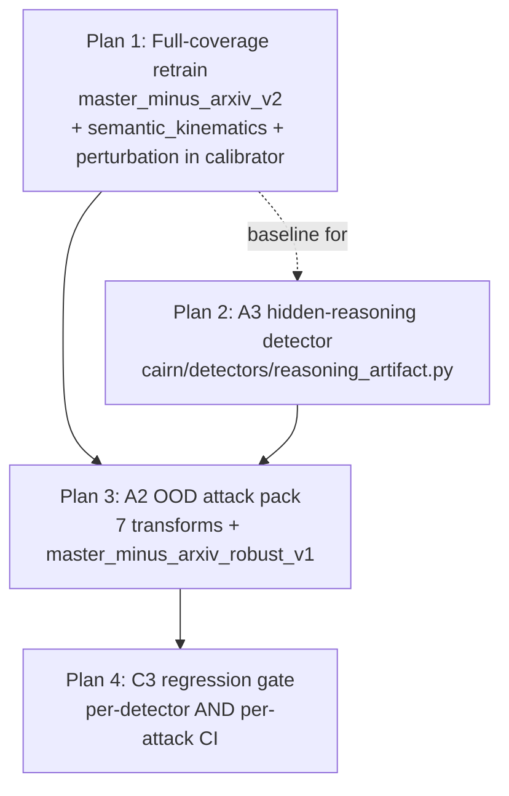

# Next-wave plan — full-coverage retrain → A3 → A2 → C3

## Context

The honest-calibration plan (Phases 0–10) is fully landed (commits `3a20213…777e623` + Phase 10 `semantic_kinematics`). From the post-honest-calibration roadmap, sprint-zero, Wave 1 (A1/B1/B2/C1), B3, and B4 all shipped (`c81ed0e`, `7723b94`, `f0995da`, `4ad116e`). **Open from that roadmap:** A2, A3, A4, A5, C2, C3.

The May 7 full-coverage experiment (`5d5b28c`, `65febaf`) recorded three findings that change the right next move:

1. The cascade short-circuit hides `perturbation` entirely (n/a → 0.7582 AUROC) and suppresses `contrastive_lm` (0.7613 → 0.8324).
2. `semantic_kinematics` is anti-correlated on calib2000 (AUROC 0.17 / 0.24) **because it isn't in `master_minus_arxiv/detector_calibration.json`** — the heuristic prior in `cairn/detectors/semantic_kinematics.py:97-106` follows the wrong direction on Q&A data; the EBM is unconstrained on it (`ca7de4f`) so a calibrator pass can recover it.
3. `token_cohesiveness` and `mixed_boundary` are at random under both regimes.

The benchmark doc explicitly concludes "the case for full-coverage retraining is empirically stronger." That gates the value of A2/A3: retraining against richer features now (Plan 1) raises the bar A2 has to clear, and A3's hidden-reasoning gain is measured against the same retrained baseline.

User asked for plans for all four candidates; this document sequences them as a single wave with explicit dependencies.

## Sequencing



**Why this order**

- **P1 + P2 in parallel** — independent code paths, both need to land before A2's "+robust" profile so the unaugmented baseline they produce is the one A2 must beat. P2 doesn't touch the EBM corpus, so it can ship as its own detector without waiting for P1's retrain.
- **P3 after P1+P2** — the augmented retrain in A2 needs the v2 calibrator + reasoning_artifact detector folded in so the per-attack numbers are honest.
- **P4 last** — the per-attack baseline CSV doesn't exist until A2 publishes it.

## Repo facts that constrain every plan

- `data/` and `models/` paths in plans are relative to the **parent repo** at `C:\Users\occam\My Projects\LLM Detector Reboot\`. The current worktree has `models/calib2000/profiles/master_minus_arxiv/` (commit `8e8123a`) but no `data/` directory. Every retrain/calibration step must run from the parent or pass absolute paths.
- Profile configs are dot-prefixed: `configs/.profile_master_minus_arxiv.yaml`, `configs/.profile_full_coverage.yaml`, etc. `ls -a configs/` to enumerate.
- Cascade phase membership lives in `cairn/cascade.py:5-13` — the source of truth that `README.md`'s phase table mirrors.
- `master_minus_arxiv/detector_calibration.json` currently has 10 keys; **missing**: `semantic_kinematics`, `perturbation`, `contrastive_gen`, `dna_gpt`, `cross_similarity`. P1 fixes the first two; the API-call detectors stay out by design.
- Existing transforms in `cairn/adversarial/transforms.py`: `strip_preamble`, `inject_typos`, `casualize`, `synonym_swap`, `mix_human`, `coached_casual`, `paraphrase_launder`. The roadmap says 5; actual is 7. P3 must reuse these names — don't duplicate.

---

## Plan 1 — Full-coverage retrain (`master_minus_arxiv_v2`)

**Goal.** Produce a retrained `master_minus_arxiv` profile whose detector_calibration includes `semantic_kinematics` and `perturbation`, trained on full-coverage features (cascade short-circuit OFF). Promote only if the standard held-out OOD slate ≥ baseline.

### Files

| File | Change |
|---|---|
| `scripts/cache_pipeline_features.py` | Reuse as-is. Run once with `configs/.profile_full_coverage.yaml` against `data/calib2000_v6_train.jsonl`. Output: `data/all_features_v6_full.jsonl`. |
| `scripts/modal_cache_features.py` | Reuse for the GPU-bound `perturbation` pass on training corpus (~94 K rows). |
| `scripts/calibrate_detectors.py` | Run against the new full-coverage cache. No code change — it iterates over whatever `LayerResult` keys are present in the cache, so adding `semantic_kinematics` + `perturbation` is data-driven. |
| `scripts/train_fusion.py` | Run with `--features-cache data/all_features_v6_full.jsonl` and `--config configs/.profile_master_minus_arxiv.yaml`. New artifact lands at `models/calib2000/profiles/master_minus_arxiv_v2/`. |
| `scripts/calibrate_conformal.py` | Run after `train_fusion`; v3 router-conditional Mondrian, same as today. |
| `scripts/run_benchmark.py` + `scripts/run_raid_benchmark.py` | Run on the standard slate: `data/calib2000_full_test.jsonl`, `data/ood_raid_test.jsonl`, `data/ood_mage_test.jsonl`, `data/ood_m4_test.jsonl`, `data/verb_low.jsonl`, `data/prompts_*.jsonl`. |
| `docs/benchmarks/calib2000/master_minus_arxiv_v2/` | New directory: `EvalReport` JSON per slice + `summary.csv` with v1 vs v2 deltas. |
| `cairn/detectors/semantic_kinematics.py:97-106` | **Do not hand-flip.** The honest fix is calibrator-driven; the file stays as-is. Add a comment near `_heuristic_p_llm` referencing the v2 calibrator that supersedes the heuristic. |
| `configs/.profile_master_minus_arxiv.yaml` | Bump `_artifact_version: v2` annotation; point any explicit artifact paths at `_v2/`. |
| `models/calib2000/profiles/master_minus_arxiv/` | Promote-on-pass: rename current to `master_minus_arxiv_2026-04-07/` (rollback path), then move `_v2` artifacts to `master_minus_arxiv/`. Mirrors C2's planned promotion convention. |
| `docs/SESSION_RECAP.md` or new `docs/SESSION_RECAP_2026-05-08.md` | Append v1→v2 delta table. |

### Promotion gate

| metric | floor (vs v1) |
|---|---|
| in-domain HC3 prose AUROC | ≥ -0.005 |
| RAID AUROC | ≥ +0.00 |
| MAGE AUROC | ≥ +0.00 |
| M4 AUROC | ≥ -0.005 |
| `verb_low` AUROC | ≥ -0.005 |
| ECE on each slice | ≤ +0.005 |

If `semantic_kinematics` post-calibration AUROC is still < 0.50 on the in-domain test slice, re-run with the detector excluded (its `_missing` indicator handles absence) and document why in the session recap. This is not a blocker for the v2 promotion.

### Verification

1. `pytest -q` — full suite must stay green; ~340+ passing.
2. `python scripts/per_detector_auroc.py --calibrator models/calib2000/profiles/master_minus_arxiv_v2/detector_calibration.json …` — assert `semantic_kinematics` AUROC moves above 0.50 on at least one of {in, raid, mage}; assert `perturbation` ≥ 0.70 on in-domain.
3. `python scripts/run_raid_benchmark.py --dataset data/ood_raid_test.jsonl --config configs/.profile_master_minus_arxiv.yaml --fpr-ceiling 0.01 --min-tpr 0.40 …` — pass.
4. End-to-end smoke: `cairn gui --profile master_minus_arxiv` and submit the standard `verb_low` fixture; `/health` reports `calibration_status: "calibrated-router-conditional"` and the v2 artifact hash.

### Risk

- **`semantic_kinematics` may stay anti-correlated on prose too**, in which case the calibrator learns a flat or anti-correlated isotonic curve. That's fine — the `_confidence` feature collapses its EBM weight. The session recap should record this honestly.
- **Cache mismatch:** an EBM trained on full-coverage features expects all features to be present at inference; in production the cascade still short-circuits. The honest-calibration v7 missingness indicators handle this — `<detector>_missing=1.0` is what the model sees when phase 3 doesn't fire, and column-mean imputation (`_cairn_feature_means`) covers the value channel. `tests/test_ebm_schema_coverage.py` already asserts this; rerun.

---

## Plan 2 — A3 hidden-reasoning detector

**Goal.** Close the OpenAI Responses-API gap (~6 AUROC points behind Gemini on `calibrated_full`'s matched-comparison eval) with a Phase-2 detector targeting hidden-reasoning surface artefacts.

### Files

| File | Change |
|---|---|
| `cairn/detectors/reasoning_artifact.py` | New. Implement `Detector` Protocol. Signals: uniform-register score, surprisal-variance across reasoning-segment boundaries, transition-phrase regex hits ("Let me think…", "Let's break this down…", "Looking at this…", "First, …", "Step 1:"), intent-vs-action clause ratio. Emit `LayerResult.spans` for transition-phrase hits. |
| `tests/test_detectors/test_reasoning_artifact.py` | New. Structural: detector loads, fires on a canned reasoning-style fixture, SKIPs on too-short input, populates spans. |
| `cairn/cascade.py:10` | Add `"reasoning_artifact"` to `PHASE2_DETECTORS`. |
| `configs/default.yaml` | Add `detectors.reasoning_artifact: {enabled: true, weight: 0.85}`. |
| `cairn/gui/static/index.html` | Add `.span-reasoning_artifact` CSS class + chip in `KIND_LABELS` (per CLAUDE.md UI conventions). |
| `README.md` | Phase-2 table — add the new detector. |
| `docs/architecture.md` | Brief detector description. |
| `data/all_features_v6_full.jsonl` | Re-cache to include the new detector (cheap — only the new column). |
| `models/calib2000/profiles/master_minus_arxiv_v2/detector_calibration.json` | Refit isotonic on the new column. |

### Acceptance gate

- Per-provider AUROC delta on the matched-comparison eval narrows from ~6 → ≤ 3 points (OpenAI ≥ 0.96).
- **Cross-provider parity:** Gemini AUROC must not drop > 0.02 with the new detector wired in. If it does, the detector is over-fit and the threshold rolls back.
- `pytest -q` green.

### Risk

The detector overfits to current OpenAI surface artefacts and collapses if the API UX changes. Mitigation = the parity gate. If signals are genuinely surface-only (not register-based), expect rapid decay; document a 6-month re-evaluation cadence in the session recap.

### Sequencing note

P2 can land before P1 finishes — the only coupling is the v2 retrain in P1 will pick up `reasoning_artifact` "for free" once the column exists. If P2 ships first, P1 absorbs it without rework. If P1 ships first, P2 triggers a one-off recalibrate against the v2 cache.

---

## Plan 3 — A2 OOD attack pack (`master_minus_arxiv_robust_v1`)

**Goal.** RAID AUROC ≥ 0.73, MAGE ≥ 0.60, in-domain ≥ 0.94 (vs v2 baseline produced by P1), `verb_low` not regressed > 0.01. Per-transform table published; no transform may regress > 0.02 vs the pre-augmentation baseline.

### Files

| File | Change |
|---|---|
| `cairn/adversarial/transforms.py` | **Add 7 new transforms** (the existing 7 stay): `translation_pivot` (round-trip via NLLB-200-distilled-600M, 2-hop only), `grammar_normalize`, `style_transfer`, `burstiness_injection`, `emoji_noise`, `summarization_attack`, `humanizer_tools`. Each follows the existing `(text, **kwargs) -> str` signature. |
| `cairn/adversarial/registry.py` | Register the new transforms. |
| `tests/test_adversarial/test_transforms.py` | Per-transform structural test: comparable length, doesn't crash on edge inputs, label-preservation via embedding-cosine ≥ 0.6 threshold for label-preserving transforms (translation_pivot, grammar_normalize, style_transfer, summarization_attack); `humanizer_tools` skips when `CAIRN_ALLOW_COMMERCIAL_BENCHMARK != 1`. |
| `scripts/build_raid_aware_corpus.py` | New. Reuse `cairn/adversarial/generator.py` patterns; output `data/adversarial_raid_v1.jsonl` ~15 K rows balanced human/LLM, **provider-stratified** across calib2000 v6 providers AND **transform-stratified** so no transform > 1/12 of total. |
| `data/calib2000_v6_train.jsonl` | Append; track via new source tag `adversarial_raid_v1`. |
| `models/calib2000/profiles/master_minus_arxiv_robust_v1/` | New profile, ships **alongside** `master_minus_arxiv` (the v2 from P1). Same `_robust_v<N>` naming convention applies to future variants. |
| `scripts/run_raid_benchmark.py` | No change; rerun against the new profile + per-transform slices. |
| `scripts/per_attack_auroc.py` | New — companion to `per_detector_auroc.py`. Computes per-attack AUROC across the 14-transform expanded set; matches `per_detector_auroc.py` output schema for tooling reuse. (This is the file C3 will key its CI gate off.) |
| `docs/benchmarks/calib2000/per_attack_auroc.csv` | New; committed baseline. Lands when this plan ships. |
| `docs/benchmarks/attack_coverage.md` | New. Before/after AUROC for all 14 transforms (existing 7 + new 7). |

### Acceptance gates (release blockers)

| metric | gate |
|---|---|
| RAID AUROC on `master_minus_arxiv_robust_v1` | ≥ 0.73 |
| MAGE AUROC | ≥ 0.60 |
| HC3 in-domain prose | ≥ 0.94 |
| `verb_low` AUROC | not regressed > 0.01 vs v2 |
| **Per-transform AUROC, all 14** | no transform regresses > 0.02 vs the pre-augmentation baseline |
| **`master_minus_arxiv_robust_v1` ships alongside v2** | both artifacts coexist; v2 stays as the OOD reference |
| **No silent baseline updates** | failed per-transform gate cannot ship by raising the baseline; CSV update requires explicit commit-message rationale (C3 enforces) |

### Risk

- **Translation-pivot / summarization-attack drift label semantics.** Mitigation = embedding-cosine label-preservation test in `tests/test_adversarial/test_transforms.py`; transforms below threshold are excluded from the augmentation. (Risk-register row in the source spec at line 705.)
- **Commercial humanizer APIs churn or sunset.** Same gating pattern as A1 commercial adapters: snapshot-test against fixtures, gate live runs on `CAIRN_ALLOW_COMMERCIAL_BENCHMARK=1`, budget cap per-run. If sunset, transform falls back to skip with a recorded reason.
- **Augmented corpus harms in-domain.** The promotion gate aborts on any in-domain regression > 0.005 (matches C2's pattern).

---

## Plan 4 — C3 per-detector + per-attack regression gate

**Goal.** CI fails the build on > 0.02 AUROC drop on any detector OR any attack vs its committed baseline CSV. Baseline updates require explicit commit-message justification.

### Files

| File | Change |
|---|---|
| `.github/workflows/raid.yml` | Add two new jobs: `per-detector-auroc` (runs `scripts/per_detector_auroc.py` against `data/all_features_v6_full.jsonl` + the v2 calibrator; diffs against `docs/benchmarks/calib2000/per_detector_auroc.csv`; fails on > 0.02 drop on any row). `per-attack-auroc` (runs `scripts/per_attack_auroc.py` against the 14-transform set + `master_minus_arxiv_robust_v1`; diffs against `docs/benchmarks/calib2000/per_attack_auroc.csv`; same drop threshold). |
| `scripts/check_baseline_csv.py` | New. Used in both jobs. Loads current vs baseline CSV, prints offending rows, exits non-zero. Mirrors `tpr_at_fpr_ceiling` exit-code pattern. |
| `.github/workflows/baseline-update-discipline.yml` | New. PR-level check that fails when either baseline CSV (`per_detector_auroc.csv` or `per_attack_auroc.csv`) is modified **without** a `Baseline-Update: <reason>` line in the PR's HEAD commit body. (Use `gh pr view --json commits` in the workflow.) |
| `docs/benchmarks/calib2000/per_detector_auroc.csv` | Already exists. Becomes the gated baseline. |
| `docs/benchmarks/calib2000/per_attack_auroc.csv` | Lands in P3; gated by this plan. |
| `tests/test_ci_baseline_check.py` | New. Synthetic regression tests: (a) inject a flat-0.5 detector and assert `check_baseline_csv.py` exits non-zero; (b) inject a 0.05 paraphrase regression and assert the per-attack version exits non-zero; (c) no-op delta under 0.02 passes. |

### Acceptance gates

- Synthetic injected per-detector regression > 0.02 fails the workflow; no-op passes.
- Synthetic injected per-attack regression > 0.02 fails the workflow; no-op passes.
- Baseline CSV change without `Baseline-Update: <reason>` in commit body fails the discipline workflow; with it, passes.
- `tests/test_ci_baseline_check.py` green.

### Risk

False positives on noisy slices. Mitigation: the threshold is fixed at > 0.02 (the spec calls this out at line 226 and 644); per-row noise smaller than that doesn't trigger. If a slice is too noisy to hold 0.02, the right answer is to bootstrap-CI the cell and tighten via a separate roadmap item, not to widen the gate.

---

## Cross-cutting verification

Single end-to-end check after all four ship, run from the parent repo:

```bash
# 1. Tests
pytest -q                                                      # ~340 + new

# 2. Per-detector + per-attack baselines current
python scripts/check_baseline_csv.py \
  --current docs/benchmarks/calib2000/per_detector_auroc.csv \
  --baseline docs/benchmarks/calib2000/per_detector_auroc.csv  # tautology; should pass

# 3. RAID gate against robust profile
python scripts/run_raid_benchmark.py \
  --dataset data/ood_raid_test.jsonl \
  --config configs/.profile_master_minus_arxiv_robust_v1.yaml \
  --fpr-ceiling 0.01 --min-tpr 0.40

# 4. Provider parity for A3
python scripts/run_per_source_loo.py \
  --dataset data/sweep_matched.jsonl \
  --config configs/.profile_master_minus_arxiv.yaml
# expect OpenAI ≥ 0.96 and Gemini not regressed > 0.02

# 5. Smoke a calibrated submission through each runtime
cairn gui --profile master_minus_arxiv_robust_v1   # SPA
cairn serve --profile master_minus_arxiv_robust_v1 # FastAPI
cairn-sidecar < <(echo '{"jsonrpc":"2.0","method":"analyze","params":{"text":"…"},"id":1}')
```

`/health` on each runtime should report `calibration_status: "calibrated-router-conditional"` and the new artifact hash. The audit chain (B4, already wired) records the v2/_robust_v1 promotion in `cairn/provenance/chain.py`.

## What this plan does NOT cover

- **A4 multilingual probe** and **A5 dashboard** — defer to a follow-up wave; they don't block accuracy or release safety.
- **C2 monthly retrain runner** — its promotion gate is exactly the v1→v2→robust_v1 manual flow this plan exercises. Once those land, the runner is a ~1-week wrap-up that productizes the same flow. Defer.
- **Workstreams D–G** from the market-leadership roadmap (group-conditional Mondrian, behavioral provenance, encoder head, retrieval defense, etc.) — all out of scope for this wave.
- **`semantic_kinematics` heuristic sign flip.** P1's calibrator is the honest fix; the heuristic stays untouched. If after P1 the calibrator still can't recover the detector, that's a separate decision (drop or retire).
