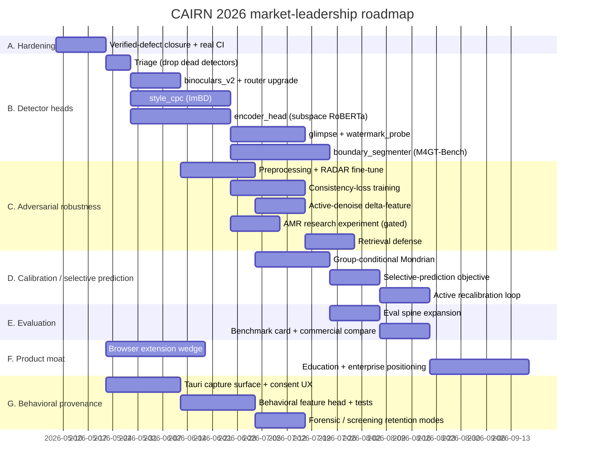

# CAIRN — Market-Leadership Roadmap

**Status:** draft for discussion
**Date:** 2026-05-07
**Scope:** consolidates two independent deep-reviews of the codebase into
a single prioritized plan to move CAIRN from "interesting calibrated
research repo" to a defensible best-in-class LLM-text detector.

---

## 1. Executive summary

CAIRN already has the parts of the system that the field rewards and that
no commercial competitor (Pangram, GPTZero, Originality, Turnitin,
Copyleaks) ships:

- a real calibration spine — EBM fusion + per-detector isotonic +
  split-conformal — trained on a 94K six-provider corpus
  (`models/calib2000/`)
- honest scientific discipline — 13-profile grid, per-source LOO,
  loss-filter ablations, OOD validation against held-out RAID/MAGE/M4
- a clean separation of routing → detection → fusion → conformal →
  decision (`cairn/pipeline.py`, `cairn/router.py`, `cairn/cascade.py`,
  `cairn/decision.py`) so the engine is replaceable without rebuilding
  the car
- three runtimes (stdlib HTTP, FastAPI, Tauri sidecar) sharing one
  single-file SPA with span-level evidence and audit-chained
  provenance (`cairn/provenance/chain.py`)

The gaps are simpler and more brutal:

1. **Six of sixteen detectors carry near-zero signal** on calib2000
   (`token_cohesiveness`, `mixed_boundary`, `fingerprint_vocab`,
   `preamble`, `surprisal_dynamics` (inverts OOD), and arguably
   `voice_spec`/`prompt_structure` outside their narrow domain).
2. **The principled core (`contrastive_lm` at AUROC 0.88 in-dist) is
   under-leveraged** — gated behind cheaper heuristics in the cascade.
3. **No paraphrase / humanizer / homoglyph robustness.** RAID AUROC sits
   at 0.6841 on the production profile.
4. **No segment-level evidence** for mixed-authorship — the dominant
   real-world case and a product-table-stakes feature for GPTZero and
   Pangram.
5. **No 2025–2026 SOTA techniques** — no Style-CPC for revised text,
   no Glimpse/DALD for closed-API logprob scoring, no subspace-pruned
   encoder, no RADAR-style adversarial training, no retrieval defense.
6. **Concrete, verified service-layer defects** — pickle-load RCE
   surface, openai-compat SSRF surface, a privacy-default regression
   in `HistoryStore`, a runtime bug in `contrastive_gen`, and a broken
   `Dockerfile`.
7. **CI is one synthetic RAID smoke gate.** No security pipeline, no
   lockfile, no signed artifacts, no SBOM.
8. **No behavioral provenance.** The Tauri shell + sidecar
   architecture is uniquely able to capture the *act of writing*
   alongside the text, but it ships as a thin renderer today —
   keystroke cadence, paste bursts, and revision graphs are not
   recorded. This is the one signal class no web-only competitor
   can ever ship, and it is currently leaving the moat unwalled.
9. **No demographic-fair calibration story.** Conformal coverage is
   marginal across the calibration set — disparate FPR across
   ESL/native or simple/complex prose is unmeasured and
   unmitigated. This is the dominant PR / legal failure mode for
   commercial detectors.

This roadmap fixes those in priority order and lands at a quantified
target: **≥ 0.85 recall at FPR ≤ 0.005 with published 95% CI**, on
public benchmarks, with conformal-honest abstention and per-provider
calibration. Pangram is the only commercial detector that holds that
operating point today; CAIRN should be the only one that holds it
*and* ships local-first with cryptographic provenance.

---

## 2. Where the system stands today (honest snapshot)

### 2.1 Production benchmark numbers (`master_minus_arxiv` profile)

| metric | today | ceiling needed to lead |
|---|---|---|
| in-domain AUROC | 0.9028 | ≥ 0.96 |
| RAID AUROC (adversarial) | **0.6841** | ≥ 0.85 |
| MAGE AUROC | **0.5667** | ≥ 0.78 |
| verb_low AUROC | 0.8908 | ≥ 0.93 |
| ECE | ~0.04 | ≤ 0.025 |
| recall @ FPR ≤ 0.005 (medium-long) | not measured | **publish, target ≥ 0.85** |
| segment-level F1 (mixed text) | not measured | **publish, target ≥ 0.85** |
| watermarked-text z-test | absent | implement; report p-value |

Source: `docs/benchmarks/README.md`, `docs/benchmarks/calib2000/`.

### 2.2 Per-detector empirical AUROC (`per_detector_auroc.csv`)

| detector | in | m4 | raid | mage | action |
|---|---|---|---|---|---|
| `contrastive_lm` | **0.88** | 0.68 | 0.61 | 0.55 | **Promote to Phase 1** |
| `instruction_density` | 0.83 | 0.74 | 0.48 | 0.55 | Keep |
| `nssi` | 0.82 | 0.61 | 0.65 | 0.53 | Keep |
| `voice_spec` | 0.75 | 0.76 | 0.47 | 0.46 | Keep, prompt-domain only |
| `prompt_structure` | 0.73 | 0.70 | 0.62 | 0.44 | Keep, prompt-domain only |
| `surprisal_dynamics` | 0.59 | 0.35 | 0.36 | **0.27** | **Drop** (inverts OOD) |
| `fingerprint_vocab` | 0.54 | 0.56 | 0.55 | 0.52 | **Drop** |
| `mixed_boundary` | 0.51 | 0.51 | 0.50 | 0.49 | **Drop** (replace with boundary model) |
| `token_cohesiveness` | 0.50 | 0.50 | 0.50 | 0.50 | **Drop** |
| `preamble` | 0.52 | 0.50 | 0.50 | 0.50 | **Demote** to override-only |

### 2.3 Verified service-layer defects

| severity | finding | file:line | fix path |
|---|---|---|---|
| Critical | `pickle.load` from config-controlled path → RCE | `cairn/fusion/training.py:54` | `skops.io.load` + checksum |
| Critical | `_generate_baselines` references `config` without it being a parameter — runtime `NameError` on openai-compat | `cairn/detectors/contrastive_gen.py:223-225` vs `:262` | Pass `config` as arg, mirror `dna_gpt.py:209` pattern |
| High | `HistoryStore.__init__` defaults `retain_text=True`; `configs/default.yaml:121` defaults `false`; `sidecar.py:149`, `gui/server.py:43` fall back to `True` if key missing → privacy regression by default | `cairn/history.py:72` | Flip default to `False`; update three call sites; add regression test |
| High | `openai-compat` `base_url` not validated → SSRF | `dna_gpt.py:209-212`, `contrastive_gen.py:262-265` | `validate_public_https_base_url()` helper |
| High | Detector discovery only catches `ImportError`; constructor or attribute errors silently lose detectors | `cairn/detectors/__init__.py:27-28` | Catch `Exception`, log to `_missing` with traceback |
| High | `Dockerfile` does `COPY cairn ./beet` (BEET → CAIRN rename leftover); image is at minimum confusing, likely broken | `Dockerfile:10` | `COPY cairn ./cairn` |
| Medium | `_redact()` matches literal substrings; provider-specific secret keys can slip through | `cairn/api.py:51-54` | Add provider-prefix patterns; redact by structure |
| Medium | One CI workflow (RAID smoke). No bandit, pip-audit, mypy, ruff, lockfile | `.github/workflows/raid.yml` | Full pipeline; see §6 |

---

## 3. Strategic principles

These constrain everything below. Disagreement on any one of them
should change the plan, not be quietly absorbed.

1. **Calibration discipline is the moat.** The honest-calibration
   sprint already shipped 4-tier `calibration_status` + Mondrian
   conformal v3. Don't trade that for raw AUROC. Every new head
   feeds the EBM stacker; no head replaces the conformal layer.
2. **Local-first + auditable is the second moat.** Tauri sidecar +
   hash-chained provenance + on-prem deployment is what no
   commercial vendor offers. Anything that breaks loopback /
   on-prem deployment needs explicit justification.
3. **Optimize selective prediction, not binary AUROC.** The metric
   that distinguishes a deployable detector from a research repo
   is recall at strict FPR with the option to abstain. Train for
   it.
4. **Adversarial robustness is non-negotiable.** A detector that
   collapses on DIPPER paraphrase or homoglyph swaps is not a
   2026 detector.
5. **EBM stays as meta-layer, encoder becomes one strong head.**
   The interpretability surface (additive contributions, span
   evidence) is a product feature; replacing the EBM with an
   opaque encoder breaks that. New encoders feed the stacker
   alongside detector outputs.
6. **Watermarks are positive-only evidence.** When a green-token
   z-test fires, push toward LLM. When it doesn't fire, push
   nothing — most providers don't watermark.
7. **No new detector ships without acceptance gates** — see §7.
8. **Behavioral provenance is opt-in, Tauri-only, and not
   deterministic.** Capture of typing/paste/revision data is a
   net-new privacy surface; default to disabled, require explicit
   consent, and design the EBM so it works correctly when
   behavioral signals are absent (web/API submissions). Behavioral
   evidence is *strong corroboration when present*, never an
   override-grade verdict.
9. **Honest framing on every claim.** Three temptations to refuse:
   "100% accuracy from behavioral fusion" — defeated by manual
   retyping; "mathematically unbiased FPR across demographics" —
   group-conditional conformal reduces but does not eliminate
   disparity, and demographic ground truth is ethically fraught
   to collect; "100% deterministic from watermark detection" —
   watermarks can be stripped (arxiv 2405.20777). Use the
   accurate version of each claim or don't make it.

---

## 4. Workstream A — Immediate hardening (sprint 1, ~2 weeks)

Zero modeling work. All gate-blockers for the rest of the roadmap.

### A1. Fix the verified service-layer defects

| task | file:line | acceptance |
|---|---|---|
| Pass `config` to `_generate_baselines`; mirror `dna_gpt.py` pattern | `contrastive_gen.py:223-225` | regression test that exercises openai-compat path |
| Add `cairn/security/url_policy.py::validate_public_https_base_url`; gate at both call sites | `dna_gpt.py:209`, `contrastive_gen.py:262` | unit tests cover loopback, link-local, private, scheme variations |
| Replace `pickle.load` with `skops.io.load` + sha256 sidecar verification; constrain to `models/` root | `fusion/training.py:47-54` | refuse to load outside trusted dir; refuse on checksum mismatch |
| Flip `HistoryStore.__init__` default to `retain_text=False`; update `sidecar.py:149`, `gui/server.py:43` to match config-default; add regression test that omitting the key gives hash-only | `history.py:72` | `tests/test_history.py` asserts default-false invariant |
| Catch `Exception` in detector discovery; log full traceback to `_missing` | `detectors/__init__.py:27-28` | unit test injects a constructor error and asserts the detector lands in `get_missing_detectors()` |
| Fix Dockerfile path | `Dockerfile:10` | image build + `cairn --version` smoke in CI |
| Extend `_redact()` to provider-prefix patterns (`anthropic_*`, `openai_*`, `google_*`) and structure-aware (any string > 32 chars under a `*_key`-suffixed key) | `api.py:51-54` | unit tests cover historical leakage cases |

### A2. Real CI

Replace the single RAID workflow with:

```yaml
jobs:
  test:        pytest -q across Python 3.11 / 3.12
  lint:        ruff check
  type:        mypy cairn
  security:    bandit -r cairn -x tests; pip-audit
  raid-smoke:  existing harness on the synthetic fixture
  artifact:    pip wheel + signed sha256 sidecar; upload as workflow artifact
```

Pin dependencies via `requirements.lock` produced from `pip-compile`.
SBOM generation (`pip install cyclonedx-bom`) on release tags only.

### A3. Acceptance gate for sprint 1

- All seven §2.3 defects closed with tests.
- Full CI pipeline green on a PR.
- No regression on `pytest -q` (~340 → keep ~340 + new tests).
- `Dockerfile` build smokes `cairn --version` in CI.

---

## 5. Workstream B — Detector triage and modern heads (Q1, ~6–10 weeks)

### B1. Triage the dead weight (week 1, no risk)

- Drop `token_cohesiveness`, `fingerprint_vocab`, `mixed_boundary` from
  `cairn/cascade.py::PHASE{1,2,3}_DETECTORS` and from
  `configs/default.yaml`.
- Demote `preamble` to an override-only signal — the CRITICAL match
  path in `decision.py:16-20` survives, but its weight in fusion goes
  to zero.
- Drop `surprisal_dynamics` from default profiles; keep the file as
  reference but mark it deprecated.
- Promote `contrastive_lm` to Phase 1.

**Acceptance:** in-domain AUROC must not regress more than 0.005;
RAID must improve at least 0.02 from removing the brittle heuristics
that adversaries strip.

### B2. New detector heads

In priority order:

1. **`binoculars_v2`** — replace the heuristic baseline-prior in
   `contrastive_lm` with the actual Binoculars cross-perplexity ratio
   (Falcon-7B / Falcon-7B-Instruct or quantized smaller pair). Lazy
   load. Calibrate isotonic on `data/calib2000_v6_train.jsonl`.
   *Expected:* in-dist parity, RAID +0.05–0.10.
2. **`style_cpc` (ImBD-port)** — Style Preference Optimization +
   Style-CPC head. Targets human-seed + LLM-polish text where
   curvature methods collapse. Train on a labeled
   `revision: {original|polished|expanded}` slice of calib2000.
   *Expected:* +6–10 AUROC on the revised-text slice; new column
   in `per_detector_auroc.csv`.
3. **`encoder_head`** — single ModernBERT/DeBERTa-class long-context
   encoder, trained with subspace-pruned embeddings (Restricted
   Embeddings, arxiv 2410.08113). Output is a single
   `encoder_p_llm` scalar fed to the EBM as one feature among many.
   *Expected:* +9–14 AUROC on MAGE; in-dist near-saturation.
4. **`glimpse`** — top-k logprob scoring against the *target* model's
   API (Anthropic top-k, OpenAI logprobs). Phase-3 detector under the
   tier-3 extras pattern; reuse the `contrastive_gen` privacy
   boundary (only task description, never submission). DALD-style
   distribution alignment when target logprobs are unavailable.
   *Expected:* closes the closed-source-model handicap.
5. **`watermark_probe`** — Kirchenbauer green-token z-test;
   SynthID-aware variant when input metadata indicates Google-family
   provider. **Positive-only contribution to the EBM** —
   non-firing must not depress LLM probability. Phase-1 cheap.
   **Fast-path early-exit:** when the z-score crosses a
   high-confidence threshold (configurable, default p < 1e-6),
   skip the rest of the cascade and return RED with a
   `watermark_match` reason. Typical runtime: < 5 ms total. Does
   not bypass the conformal layer — the prediction set still
   reports the watermark-conditional interval.
   **Honest framing:** watermarks can be stripped (Black-Box
   Watermark Detection, arxiv 2405.20777); a positive z-test is
   *near*-deterministic, not absolute.
   *Expected:* near-deterministic correct call when watermark
   present (~10%+ of Google traffic); zero contribution otherwise.
6. **`boundary_segmenter`** — **token-level** binary classifier
   (human vs LLM) with a CRF or BiLSTM head over a transformer
   encoder, trained on M4GT-Bench boundary labels. Output a
   per-token probability vector; aggregate to per-sentence and
   per-paragraph `p_llm` scores plus a document
   `mixed_proportion` and `boundary_count` feature for the EBM.
   Surface exact start/end indices on `LayerResult.spans` so the
   UI can highlight sub-sentence "cyborg" interventions.
   **Replaces `mixed_boundary`.**
   *Expected:* token-level F1 ≥ 0.80 and segment F1 ≥ 0.85 on
   M4GT-Bench held-out; sub-sentence localization in the UI.

### B3. Replace the regex router

`cairn/router.py:52-124` is hand-rolled regex. Replace with a 5-feature
logistic regression over `{word_count, imperative_density,
second_person_density, sentence_length_mean, bullet_ratio}` trained
against the prompts-only corpus. Surface `router.calibration_status`
on `/health`.

**Acceptance:** routing accuracy on a held-out router-eval set ≥ 0.95;
no degradation in downstream determination accuracy.

### B4. Acceptance gates for Workstream B

- Per-detector AUROC table re-published; every retained detector
  ≥ 0.65 in-dist or has a documented architectural reason.
- In-domain AUROC ≥ 0.95.
- New `per_revision_auroc.csv` published with `style_cpc` carrying
  it.

---

## 6. Workstream C — Adversarial robustness (Q1/Q2, ~6–8 weeks)

### C1. Preprocessing layer

`cairn/preprocessing/normalize_text.py`:

- Homoglyph normalization (Cyrillic-Latin, Greek-Latin lookalikes)
- Zero-width character stripping (U+200B, U+200C, U+200D, U+FEFF)
- Whitespace canonicalization (no-break space, ideographic space)
- Recorded as a discrete transform in the audit chain so reviewers
  can see what was normalized

**Gate by config** (`preprocessing.normalize: true|false|audit_only`).
Audit-only mode flags but doesn't strip — useful for forensic mode.

### C2. RADAR-style adversarial fine-tuning

The RAID corpus already has the attack matrix (`data/ood_raid.jsonl`).
Add a corpus-augmentation flag to `scripts/train_fusion.py`:

- For each in-dist sample, pair with its DIPPER-paraphrased twin
  labeled identically.
- Train EBM (and `encoder_head`) on the doubled corpus.
- Validate on RAID held-out and on a separate paraphrase-only test
  set.

**Expected:** RAID 0.68 → ≥ 0.85.

### C3. Consistency-loss training

Beyond label-preservation: enforce **score stability** under
meaning-preserving rewrites. For paired (original, rewrite) samples
where label is preserved, penalize `|score(original) - score(rewrite)|`
in the encoder-head training objective. If a rewrite would flip a
verdict (RED → GREEN), force abstention rather than commit either
way.

This makes paraphrase robustness a *training-time* invariant rather
than an evaluation-time hope.

### C4. Active denoising with delta-feature

The homoglyph / zero-width preprocessing in §6 C1 strips visible
evasion artifacts but does not catch synonym-substitution or
forced-typo humanizer attacks. Add a stronger denoising pass:

- Run the input through a small local instruction-tuned LLM
  (e.g., Qwen2.5-1.5B, lazy-loaded) with a fixed prompt: "Fix
  typos, spelling, and grammatical errors. Preserve meaning and
  style. Return only the corrected text."
- Re-score the denoised text through the full detector cascade.
- Compute `score_delta = score(denoised) - score(raw)` and feed
  it to the EBM as a new feature.

A large positive delta (denoised text scores much more LLM-like
than raw) is a near-pathognomonic signature of adversarial
evasion: humanizers add noise that pushes the *raw* score toward
human while the *underlying generation* remains LLM-like.

**Cost:** one extra encoder pass (~100 ms CPU, < 20 ms GPU).
Gate by config (`preprocessing.active_denoise: true|false`).
Forensic profiles enable; screening profiles do not.

**Honest framing:** this is a *feature feeding the EBM*, not a
binary verdict. It catches obfuscation attempts but does not on
its own determine the label.

### C5. AMR (Abstract Meaning Representation) graph density — research track

Humanizers can change syntax and vocabulary but struggle to alter
the underlying logical structure. AMR parsing (e.g., `amrlib`)
extracts a directed graph of predicate–argument relations whose
*density* (edges per node, root-to-leaf depth, inverse-relation
ratio) discriminates LLM-dense logical prose from human writing.

This is research-stage, not a committed deliverable. Open
questions: parser quality on long documents, latency at
production scale, generalization beyond the AMR-3.0 training
distribution. Scope as a 2-week experiment after the encoder
head lands; ship only if the held-out signal contributes ≥ 0.02
AUROC at fixed FPR over the EBM-without-AMR baseline.

### C6. Retrieval defense (Krishna et al.)

Build `cairn/retrieval/GenerationStore` — opt-in MinHash index of
API-generated text. Existing `contrastive_gen` and `dna_gpt` already
make these calls; persist them with timestamps and provider tags. At
inference, if MinHash similarity to any stored generation > τ, force
RED with `retrieval_match` reason (and surface the matching
generation in the audit log).

Won't catch non-API traffic; decisive when it fires. Cheap given the
existing call graph.

### C7. Acceptance gates for Workstream C

- RAID AUROC ≥ 0.85 on `master_minus_arxiv` + adversarial training.
- Homoglyph swap test (Cyrillic-Latin substitution): AUROC drop
  < 0.02 vs. clean.
- Score stability under meaning-preserving rewrites (DIPPER): mean
  `|Δscore|` < 0.10 or forced abstention.
- Retrieval defense: 100% recall on stored seed generations,
  documented false-positive rate against natural rephrasing.
- Active-denoise delta-feature: AUROC contribution ≥ 0.02 over
  the EBM-without-delta baseline on held-out humanizer corpus
  (StealthGPT, Undetectable.ai, BypassGPT round-trips).

---

## 7. Workstream D — Calibration and selective prediction (Q2, ~4–6 weeks)

### D1. Group-conditional Mondrian conformal

Extend the existing Mondrian conformal v3 to bucket along three
dimensions:

1. **Provider** — `{anthropic, openai, gemini, mistral, deepseek,
   moonshot, unknown}` for provenance-known submissions.
2. **Linguistic complexity** — `{simple, moderate, complex}`,
   estimated by a lightweight syntactic classifier in
   `cairn/normalizer.py` over `{mean dependency depth, type-token
   ratio, function-word ratio, mean clause-per-sentence}`. This is
   the closest legitimate proxy for ESL/native distinction *without
   collecting demographic labels*.
3. **Length** — `{short (<150w), medium (150–1000w), long (>1000w)}`.

Marginal coverage on a mixed deployment is currently a fiction;
per-bucket calibration gives honest intervals when bucket
membership is identified, and explicitly publishes per-bucket FPR
in the benchmark card (§8 E2).

**Honest framing on demographic fairness.** Group-conditional
conformal calibration *reduces* disparate FPR across
ESL/native/neurodivergent populations; it does not mathematically
*eliminate* it. True demographic-fair calibration would require
ground-truth demographic labels, which are ethically fraught to
collect at scale and legally sensitive in most jurisdictions. The
"world's first mathematically unbiased detector" marketing claim is
overstated and should not be made. The supportable claim is
"complexity-bucketed conformal coverage with documented per-group
FPR" — which is still substantively better than any commercial
competitor's offering today.

### D2. Length-conditional abstention

`cairn/decision.py` should return `UNCERTAIN` at `word_count < 100`
unless the conformal interval is tight (< 0.15 wide). Today a 50-word
fragment gets the same treatment as a 1000-word essay — this is a
known commercial-detector failure mode (Booth/UChicago 2025: sharp
degradation under 50 words).

### D3. Selective-prediction objective

Reframe the `train_fusion.py` objective from cross-entropy on all
samples to **risk-controlled selective accuracy** — accuracy at the
target FPR, conditional on the model not abstaining, with abstention
budget capped (e.g. ≤ 15%). Existing conformal abstention machinery
provides the abstain channel; this changes what's optimized.

### D4. Active recalibration loop

`cairn/monitoring/meta_detector.py` already flags drift. Wire
`RuntimeContext.switch_profile()` to auto-trigger
`scripts/train_fusion.py` on a rolling window of feedback when
ECE > 0.10 for N consecutive batches. Opt-in with UI confirmation;
result swapped atomically per the existing
`RuntimeContext.switch_profile()` contract.

### D5. Acceptance gates for Workstream D

- Per-provider conformal coverage at α=0.05 within ±0.02 of nominal
  on each bucket (validated on held-out per-provider slices).
- Length-conditional abstention: zero verdicts on word_count < 50
  unless conformal width < 0.10.
- Selective-prediction objective: recall ≥ 0.85 at FPR ≤ 0.005 on
  medium-long passages, with abstention rate ≤ 15%.
- Drift-triggered recalibration: end-to-end test that a synthesized
  drift event triggers a re-fit and atomic profile swap without
  pipeline downtime.

---

## 8. Workstream E — Evaluation spine and public benchmark card (Q2/Q3, ~3 weeks)

### E1. Add to the eval spine

Beyond existing HC3 / RAID / MAGE / M4 / verb_low:

| benchmark | use for |
|---|---|
| **OpenTuringBench** | unseen-open-model generalization |
| **M4GT-Bench** | mixed-text boundary task (drives `boundary_segmenter`) |
| **DetectRL** | real-world attack-mixed split (current Binoculars ceiling: 79.6%) |
| **PADBen** | paraphrase-attack-specific |
| **Repo prompt corpus** | prompt-authorship — product differentiator |

TuringBench (older) is optional. Skip GLTR as a comparator; keep it
only as an explanation channel.

### E2. Publish the benchmark card

Single CSV + Markdown table per release:

| benchmark | profile | n | AUROC | recall@FPR=0.5% | ECE | abstention% | 95% CI |
|---|---|---|---|---|---|---|---|

Compare apples-to-apples against any commercial detector that
publishes numbers. **The headline metric is recall at FPR ≤ 0.005,
with confidence intervals.** Pangram is the only commercial detector
that holds this; CAIRN should be the only one that holds it
*and* ships local-first.

### E3. Acceptance gates for Workstream E

- Benchmark card published in `docs/benchmarks/release_<vN>.md`
  with reproducibility instructions and git SHA pinning.
- Every metric carries a 95% CI from bootstrap resampling.
- Re-run is ≤ $1 of compute (Modal T4) per commit-time spot check.

---

## 9. Workstream F — Product moat (Q2/Q3, ongoing)

CAIRN's local-first + calibrated + auditable architecture is uniquely
positioned for segments commercial vendors leave on the table. None of
this is modeling work; it's distribution.

- **Education vertical.** Auditable on-prem detector with conformal
  intervals + per-classroom retention policy + teacher-feedback
  recalibration loop. Direct disruption of Turnitin's closed
  black-box.
- **Enterprise compliance / publishing.** Hash-chained provenance
  (`cairn/provenance/chain.py`) is rare. Package as
  "cryptographically verifiable detection trail." Add SOC2-aligned
  retention controls and per-tenant audit log export.
- **Browser extension.** Most direct competitor wedge. The Tauri
  shell + sidecar is the model; a WebExtension calling localhost is
  ~2 weeks.
- **Public reproducible benchmark vs. commercial vendors.** Run the
  same harness against Pangram / GPTZero / Originality on a
  third-party held-out corpus. Publish apples-to-apples numbers.
  Right now everyone publishes self-favorable evals; whoever
  publishes apples-to-apples wins the trust battle.

---

## 10. Workstream G — Behavioral provenance (Tauri shell only) (Q3, ~6–8 weeks)

The Tauri sidecar architecture is uniquely positioned for an angle
no web-based competitor (Pangram, GPTZero, Originality, Copyleaks,
Turnitin) can match: capture the *act of writing* alongside the
text itself.

This is **not a replacement for textual detection**. Submissions
through the FastAPI server, the stdlib HTTP GUI, the CLI, or any
non-editor surface cannot have behavioral signals — the EBM must
work correctly when behavioral data is absent. But for the
in-editor product surface (education vertical, drafting tools,
forensic mode), it adds a feature head whose signal is **fully
orthogonal** to every NLP signal in §5.

### G1. Capture surface

Behind an explicit opt-in (`gui.behavioral.enabled: false` by
default), the Tauri shell records:

- **Typing cadence** — inter-keystroke interval distribution per
  session, segmented per paragraph.
- **Burst structure** — runs of consecutive characters with
  intervals < 50 ms (typical paste signature).
- **Backspace / revision ratio** — edits per 100 characters,
  revisions per paragraph, distance between current insertion
  point and most recent edit.
- **Clipboard paste events** — timestamp, character count,
  source-application hint when available, **sha256 of pasted
  content** (raw paste text never persisted).
- **Document revision graph** — checkpoint diffs at sentence
  boundaries, with per-checkpoint timestamps.

Stored in a new `cairn/behavioral/store.py` aligned with the
existing `cairn/privacy/store.py` retention contract:
best-effort writes, hash-only by default, retention controls
per-tenant, full deletion API.

### G2. Behavioral feature head

`cairn/detectors/behavioral.py`:

- Computes per-document statistics: mean / median / variance of
  inter-keystroke intervals; burst-rate; paste-burst-rate;
  backspace ratio; revision-graph entropy; longest single burst
  length; longest pause between bursts.
- Emits a single `behavioral_p_llm` scalar to the EBM.
- Returns SKIP with `reason="no_behavioral_data"` when the
  submission did not come through the editor (web/API/CLI) or
  when capture is opted-out — the EBM treats this exactly like
  any other SKIP signal.
- Surfaces paste-burst spans on `LayerResult.spans` so the UI
  can highlight runs that look like paste events.

### G3. Honest framing

The third-review framing of "effectively 100% accuracy from
behavioral fusion" is wrong. Behavioral signals are *defeated* by:

- A user who manually retypes ChatGPT output into the editor
  (tedious but trivially effective).
- A user who uses the web GUI / FastAPI / CLI instead of the
  Tauri shell (no behavioral data captured at all).
- A user who installs and uses a typing-replay or input-injection
  tool to synthesize human-shaped keystrokes.

The correct framing: behavioral signals are **strong
corroborating evidence when present**, never a deterministic
verdict on their own. The EBM weights them alongside textual
signals; the conformal layer accounts for their absence; the
decision engine never treats their presence as override-grade
evidence on its own (only the existing `preamble` CRITICAL
override remains).

### G4. Privacy and consent contract

Behavioral capture is privacy-sensitive in ways text submission
is not. Every deployment surface that captures behavioral data
must:

- Default to disabled.
- Show a one-time consent prompt before first capture, with a
  plain-language description of what is recorded and where it is
  stored.
- Show a visible recording indicator (icon in the editor chrome)
  while active.
- Provide a per-session export and delete API.
- Hash all clipboard content before storage; **never persist raw
  paste text**.
- Provide a `forensic` mode (retains raw events, retention
  policy per-tenant) versus a `screening` mode (keeps only
  summary statistics, immediate raw-event purge).
- Document the retention policy in the audit chain alongside
  every detection that consumed behavioral data.

### G5. Acceptance gates for Workstream G

- Behavioral feature head AUROC ≥ 0.90 on a labeled in-editor
  corpus (human-typed vs. paste-from-LLM with realistic
  manual-retype hard negatives).
- Zero capture without explicit opt-in, enforced by an integration
  test that asserts the empty event log under default config.
- Conformal coverage holds within ±0.02 of nominal across three
  buckets: behavioral-present, behavioral-partial,
  behavioral-absent — validated on a held-out per-bucket slice.
- Forensic vs. screening mode round-trip tested for the full
  retention/deletion contract.
- Privacy policy doc and consent UX reviewed before any release
  that ships the capture surface.
- Manual-retype hard-negative test: a human retyping a known
  ChatGPT output should **not** be falsely classified as LLM by
  behavioral signal alone — the textual signal must still drive
  the verdict.

---

## 11. Quantified success targets

| metric | today | release v1 (≈ 6 months) |
|---|---|---|
| in-domain AUROC | 0.9028 | ≥ 0.95 |
| RAID AUROC | **0.6841** | ≥ 0.85 |
| MAGE AUROC | **0.5667** | ≥ 0.78 |
| verb_low AUROC | 0.8908 | ≥ 0.93 |
| short-text (<150 words) AUROC w/ abstention | not measured | ≥ 0.85 |
| ECE | ~0.04 | ≤ 0.025 |
| **recall @ FPR ≤ 0.005 (medium-long)** | **not measured** | **≥ 0.85, with 95% CI** |
| segment-level F1 (M4GT-Bench) | not measured | ≥ 0.85 |
| watermarked-text z-test | absent | implemented; p-value reported |
| document-level FPR cap (policy mode) | not measured | ≤ 0.5% |
| behavioral feature AUROC (Tauri editor only) | n/a | ≥ 0.90 on labeled in-editor corpus |
| per-complexity-bucket FPR disparity (simple vs complex) | not measured | published, target Δ ≤ 0.01 |
| watermark fast-path latency | n/a | ≤ 5 ms end-to-end when triggered |
| token-level boundary F1 | not measured | ≥ 0.80 on M4GT-Bench |

---

## 12. What we're explicitly NOT doing

- **Not chasing watermarks as a primary pillar.** SynthID is useful
  but covers Google traffic only; OpenAI/Anthropic/Meta have not
  shipped public watermarks at scale.
- **Not chasing MAGE > 0.85.** Multi-author/model-attribution at
  that level is open research; aim for 0.78.
- **Not adding more LLM-backed detectors before retrieval defense.**
  `dna_gpt` and `contrastive_gen` are expensive and disabled by
  default; their slot is better filled by `glimpse` + retrieval.
- **Not breaking the heuristic-mode promise.** The honest-calibration
  discipline (`/health::calibration_status`, GUI banner,
  `_HEURISTIC_*` naming) stays.
- **Not replacing the EBM with an opaque encoder.** The encoder is
  one head feeding the stacker. The interpretability surface
  (additive contributions, span evidence) is a product feature, not
  a research luxury.
- **Not aiming for highest in-domain AUROC on one benchmark.** That
  is graduate-student bait. The headline metric is recall at strict
  FPR with conformal-honest abstention, validated on the full eval
  spine.
- **Not making any of the three overclaim-flavored marketing
  pitches.** No "100% accuracy from behavioral fusion," no
  "mathematically unbiased detector," no "100% deterministic
  watermark detection." Each of those is technically defeated and
  legally exposed. Use the supportable version of each claim or
  none.
- **Not capturing behavioral data outside the Tauri editor.** The
  FastAPI / stdlib HTTP / CLI surfaces never capture keystrokes
  or clipboard. This is a hard architectural boundary, not a
  configuration choice.
- **Not collecting demographic labels.** Linguistic-complexity
  buckets are the closest legitimate proxy; explicit ESL /
  neurodivergent / native labels are out of scope.

---

## 13. Roadmap-at-a-glance



The dates assume a 2-engineer cadence (1 ML, 1 platform/security)
plus part-time review. A solo-developer cadence at the project's
current pace would extend each section by 1.5–2x; the priority order
is unchanged.

---

## 14. Open questions

1. **Encoder backbone choice.** ModernBERT, DeBERTa-v3-large, and
   Longformer all have tradeoffs (context length, latency, license).
   Decision should be benchmarked on a 1K-sample dev split before
   committing.
2. **Glimpse provider scope.** Anthropic and OpenAI both expose
   top-k logprobs in different shapes; Gemini is more limited. Need
   a per-provider wrapper or a graceful-degrade path.
3. **Retrieval defense privacy.** Storing API generations creates a
   secondary data-retention surface. Default to opt-in; document the
   threat model; consider per-tenant retention budgets.
4. **Browser extension trust boundary.** A WebExtension calling
   localhost on `127.0.0.1:8877` is the simplest design but exposes
   the API to any site that knows the port. Token-gate the local
   API or use a per-extension shared secret.
5. **Active recalibration auto-trigger threshold.** ECE > 0.10 for
   N batches is a starting point; the right N depends on traffic
   volume. Surface as a config knob rather than hardcode.
6. **AMR parser viability.** Does AMR graph density survive a
   2-week experiment well enough to ship? Open questions:
   parser quality on documents > 500 words, latency at production
   scale, generalization beyond the AMR-3.0 training distribution.
   Ship gate: ≥ 0.02 AUROC contribution at fixed FPR over the
   EBM-without-AMR baseline; otherwise close the experiment.
7. **Behavioral capture across operating systems.** Tauri's
   keystroke and clipboard APIs differ by OS (especially on macOS
   where accessibility permissions are required). Need a
   per-OS test matrix and a graceful-degrade UX when permissions
   are denied.
8. **Manual-retype hard negatives.** How many human-retyped LLM
   samples are needed to prevent the behavioral head from
   over-fitting to "fast typing = LLM"? Likely 200–500; needs
   measurement.
9. **Demographic-fair calibration without demographic labels.** Is
   linguistic-complexity bucketing a sufficient proxy, or do we
   need a separate readability-conditional axis (Flesch-Kincaid,
   etc.)? Validate against published ESL-vs-native AI-detection
   bias studies.

---

## 15. References

### Internal

- `docs/benchmarks/README.md` — production benchmark numbers
- `docs/benchmarks/calib2000/per_detector_auroc.csv` — per-detector
  AUROC across datasets
- `docs/calibration.md` — training pipeline
- `CLAUDE.md` — invariants (calibration honesty, privacy
  boundaries, cascade membership)
- Issue #13 — "Routine review 2026-05-04 — stability + roadmap"

### External — methods

- Binoculars (Hans et al. 2024) — arxiv 2401.12070
- Fast-DetectGPT (Bao et al. 2023)
- ImBD — arxiv 2412.10432
- DALD — arxiv 2406.05232
- Glimpse — arxiv 2412.11506
- DetectAnyLLM — arxiv 2509.14268
- SpecDetect++ — arxiv 2508.11343
- Restricted Embeddings (subspace-pruned RoBERTa) — arxiv 2410.08113
- Krishna et al. retrieval defense — arxiv 2303.13408
- Adversarial Paraphrasing 2025 — arxiv 2506.07001
- PADBen — arxiv 2511.00416
- DetectRL — arxiv 2410.23746
- Kirchenbauer et al. green-list watermark — PMLR v202
- Black-Box Watermark Detection / stripping — arxiv 2405.20777
- AMR parsing (`amrlib`) — github.com/bjascob/amrlib
- Group-conditional / Mondrian conformal prediction (Vovk et al.)
- Behavioral biometrics for authorship attribution — Brizan et al.
  ACL 2015 keystroke-dynamics line of work

### External — benchmarks

- RAID — https://raid-bench.xyz/ (arxiv 2405.07940)
- MAGE — arxiv 2305.13242
- M4 / M4GT-Bench — arxiv 2305.14902
- OpenTuringBench

### External — commercial / market evidence

- BFI 2025 evaluation — https://bfi.uchicago.edu/insights/artificial-writing-and-automated-detection/
- Pangram comparison page — https://www.pangram.com/blog/best-ai-detector-tools
- GPTZero benchmarking page
- NBER 2025 working paper on artificial writing detection
